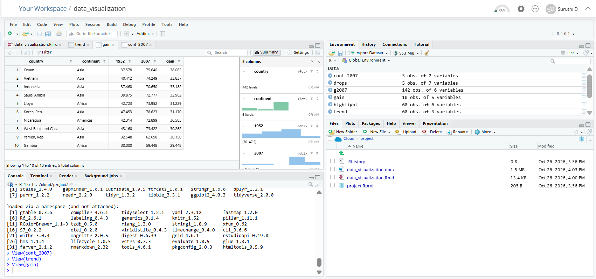

# Data Visualization and Insight Communication using R

 Dataset: gapminder. Tools: R, ggplot2, R Markdown.

## Files:
- `data_visualization.docx` - final report with code, outputs and plots (open to view)
- `data_visualization.Rmd` - R Markdown source 
## Screenshot

